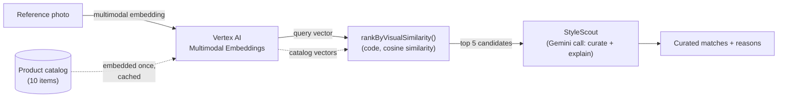
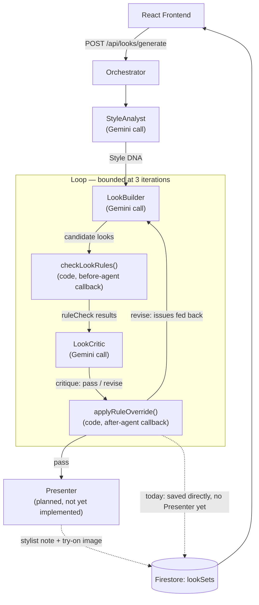

# Fitted

An AI-powered fashion and virtual try-on platform, built for a graduate
Web Systems course. Fitted started as a Project 1 frontend-only
prototype and is now a real full-stack app for Project 2: a React
frontend, an Express backend, a multi-agent Gemini pipeline, Google
sign-in with Google Photos import, Firestore persistence, and
Cloud Run deployment.

A user signs in with Google, imports or uploads photos, records a
spoken style request, and asks Fitted for look recommendations. Behind
that request, a team of agents (described below, under
**AI Agent Architecture**) analyzes the photos, builds candidate
outfits from the product catalog, and critiques them against both
hard rules and style judgment before returning a result. The one piece
still mocked is the virtual try-on preview image itself (P3) — see
**What's Not Yet Built**.

## Project Description

Fitted is designed like a real early-stage fashion startup would build
it: a small set of marketing/informational pages (Home, About,
Contact) built with traditional HTML/CSS/JS, plus a product-facing
single-page application (the "Virtual Fitting Room") and a Login page,
both built with React, all talking to a real Express backend. The
whole site shares one visual design system — a minimal, editorial,
neutral color palette meant to feel like a premium fashion brand
rather than a generic SaaS dashboard.

## Technologies

- **HTML5 / CSS3 / vanilla JavaScript** — Home, About, and Contact pages
- **Bootstrap 5** (via CDN) — responsive grid, navbar collapse, form styling
- **React 18** — the App (Virtual Fitting Room) and Login pages
- **React Router** (`HashRouter`) — client-side navigation inside the App SPA
- **Vite** — development server and production build tool, configured as a
  multi-page app (see `frontend/vite.config.js`) so the static pages and the
  two React entry points build into one `dist/` folder together
- **Node.js + Express** (`backend/`) — the real API: authentication,
  photo analysis, look generation, logging, and analytics
- **Gemini API** (`@google/generative-ai`) — every agent's structured
  reasoning call (see **AI Agent Architecture**)
- **Google Identity Services + Google Photos Picker API** — real
  Google sign-in and photo import
- **Firestore** (`@google-cloud/firestore`) — persistence for photo
  analyses, style requests, and generated look sets
- **Google Cloud Logging + Google Analytics 4** — structured server
  logs and client/server usage analytics
- **Docker + Cloud Run** — single-container production deployment (see
  **Docker Deployment**)

## Project Structure

The repo is split into a `frontend/` (the React + static-HTML client
described below) and a `backend/` (the Express API — see inline
comments in `backend/app.js` and the Project 2 proposal response doc
for its architecture):

```
fitted/
├── frontend/                  # Everything described in this README
│   ├── index.html              # Home (static HTML/CSS/JS)
│   ├── about.html               # About (static HTML/CSS/JS)
│   ├── contact.html              # Contact (static HTML/CSS/JS)
│   ├── app.html                   # Mounts the React "Virtual Fitting Room" SPA
│   ├── login.html                  # Mounts the React Login page
│   ├── vite.config.js              # Multi-page build configuration
│   ├── package.json
│   ├── public/                     # Static assets, copied as-is by Vite
│   │   ├── css/                    # shared.css (design system) + per-page CSS
│   │   ├── js/                     # main.js (shared) + contact.js
│   │   └── images/                 # Local SVG placeholder images (hero + products)
│   └── src/                         # React source (used by app.html & login.html)
│       ├── App.jsx                   # Root of the Fitting Room SPA (routing + state)
│       ├── LoginApp.jsx                # Root of the Login page
│       ├── main-app.jsx                 # React entry point for app.html
│       ├── main-login.jsx                # React entry point for login.html
│       ├── components/                     # Reusable React components
│       ├── pages/                           # Shop / Fitting Room / My Looks pages
│       ├── data/products.js                   # Mock product catalog
│       ├── services/apiClient.js               # Shared fetch wrapper to the backend
│       └── styles/                               # React-page-specific CSS
├── backend/                   # Project 2 Express API (auth, Photos, Gemini, Firestore)
│   ├── app.js                  # Entry point; also serves frontend/dist in production
│   ├── routes/ middleware/ services/ agents/ config/ data/ tests/
│   └── package.json
├── DockerContainer/            # Legacy Project 1 submission: Apache-only static-site image
│   ├── Dockerfile
│   └── README.md
├── Dockerfile                  # Project 2: combined frontend+backend Cloud Run image
└── README.md                            # (this file)
```

## Pages

| Page | File | Built with |
|---|---|---|
| Home | `index.html` | HTML/CSS/JS + Bootstrap |
| About | `about.html` | HTML/CSS/JS + Bootstrap |
| Contact | `contact.html` | HTML/CSS/JS + Bootstrap |
| App (Virtual Fitting Room) | `app.html` → `src/App.jsx` | React + React Router |
| Login | `login.html` → `src/LoginApp.jsx` | React |

## React Components

All components live in `src/components/`:

- **Navbar** — the main Fitted site navigation, re-implemented in React so
  it can appear on both the App and Login pages.
- **SpaTabs** — the Fitting Room SPA's own internal navigation
  (Shop / Fitting Room / My Looks), kept conceptually separate from Navbar.
- **ProductCard** — a single product's image, name, category, price,
  favorite (heart) button, and Select button.
- **ProductGrid** — lays out a list of products as ProductCards using
  Bootstrap's responsive grid classes; shows an empty-state message when
  the list is empty.
- **CategoryFilter** — the All / Tops / Outerwear / Dresses / Bottoms pills.
- **PhotoUploader** — lets the user choose a photo from their computer and
  previews it with the FileReader API (nothing is uploaded to a server).
- **SelectedProduct** — shows the currently-selected product and the
  "Try It On" button.
- **TryOnPanel** — shows the simulated try-on loading state and result.
- **FavoritesButton** — the reusable heart-icon toggle used inside
  ProductCard.
- **LoginForm** / **RegisterForm** — the Login page's two forms.

## React State Demonstrations

- **Lifted state** — `src/App.jsx` owns `photo`, `selectedProduct`, and
  `favoriteIds` with `useState`, and passes them (plus setter functions) down
  as props to `ShopPage`, `FittingRoomPage`, and `MyLooksPage`. This is why
  selecting a product in the Shop page is still selected when you switch to
  the Fitting Room tab.
- **Async state / loading states** — `FittingRoomPage.jsx` tracks
  `tryOnStatus` (`"idle" | "loading" | "done"`) around the `await
  simulateTryOn(...)` call, and `TryOnPanel.jsx` renders a different UI for
  each value.
- **Component-local state** — `RegisterForm.jsx` and the category filters in
  `ShopPage.jsx` / `FittingRoomPage.jsx` manage their own `useState` because
  nothing outside those components needs to see every keystroke or filter
  change.
- **Controlled inputs** — `LoginForm.jsx`'s username/password fields are
  fully controlled by `LoginApp.jsx`'s state, which is what makes it
  possible to auto-fill them after "Create Account" is submitted (see
  `LoginApp.handleAccountCreated`).
- **Derived/computed values** — `useMemo` in `FittingRoomPage.jsx` and
  `ShopPage.jsx` recomputes the filtered product list only when the active
  category changes.

## Bootstrap Features

- Responsive navbar with the `navbar-expand-lg` + `navbar-toggler` +
  `collapse` pattern (collapses to a hamburger menu below the `lg`
  breakpoint) — used on every page, including inside the React `Navbar`
  component.
- Bootstrap's grid system (`row`/`col-*`) for the Home page hero, the
  "How Fitted Works" three-column steps, the About page's three-column
  values section, and the Contact page's two-column layout.
- Bootstrap form classes (`form-control`, `form-label`,
  `was-validated`/`invalid-feedback`) on the Contact page for validation
  styling.

## JavaScript Interactions

- **Contact form validation** (`public/js/contact.js`) — uses the
  constraint-validation API (`form.checkValidity()`) and toggles a
  confirmation message with `classList`.
- **Scroll-reveal animation** (`public/js/main.js`) — an
  `IntersectionObserver` fades sections into view as the user scrolls,
  used on Home and About.
- **Active nav-link highlighting** (`public/js/main.js`) — reads
  `window.location.pathname` to mark the current page's nav link.
- **Responsive Bootstrap navbar collapse** — the hamburger menu toggle on
  every page (Bootstrap's own JS bundle).
- **Photo upload + preview, product selection, favoriting, simulated
  try-on, and the Login/Create Account flow** — all implemented as React
  event handlers and state updates (see the React State Demonstrations
  section above).

## Running Locally

```bash
cd frontend
npm install
npm run dev
```

Vite will print a local URL (typically `http://localhost:5173`). From
there:

- `/` or `/index.html` → Home
- `/about.html` → About
- `/contact.html` → Contact
- `/app.html` → Virtual Fitting Room SPA
- `/login.html` → Login

## Building the React Application

```bash
cd frontend
npm run build
```

This runs Vite's production build for **all five pages** (not just the
React ones) and outputs everything to `frontend/dist/`. Preview the
production build locally with:

```bash
npm run preview
```

## Docker Deployment

The real deployment is the root **`Dockerfile`**: the Express backend,
also serving the built frontend from the same origin, so the whole app
is one live URL with no CORS setup needed. This is what deploys to
Cloud Run:

```bash
gcloud run deploy fitted \
  --source . \
  --region us-central1 \
  --allow-unauthenticated \
  --set-env-vars GCP_PROJECT_ID=fitted-project2,VERTEX_LOCATION=us-central1,GOOGLE_OAUTH_CLIENT_ID=<client-id>,GEMINI_API_KEY=<gemini-key>,GEMINI_MODEL=gemini-2.0-flash
```

(Values for `<client-id>` / `<gemini-key>` are the same ones in
`backend/.env` — see `backend/.env.example` for what each one is.)

One-time setup before the first deploy:
1. `gcloud config set project fitted-project2`
2. Make sure Firestore can be reached from the deployed service — the
   default Compute Engine service account Cloud Run uses usually
   already has this, but if Firestore calls 403 in the logs, grant it
   explicitly:
   ```bash
   gcloud projects add-iam-policy-binding fitted-project2 \
     --member="serviceAccount:$(gcloud projects describe fitted-project2 --format='value(projectNumber)')-compute@developer.gserviceaccount.com" \
     --role="roles/datastore.user"
   ```
3. Enable Vertex AI (needed for StyleScout's visual-similarity search)
   and grant the same service account the Vertex AI User role:
   ```bash
   gcloud services enable aiplatform.googleapis.com --project fitted-project2
   gcloud projects add-iam-policy-binding fitted-project2 \
     --member="serviceAccount:$(gcloud projects describe fitted-project2 --format='value(projectNumber)')-compute@developer.gserviceaccount.com" \
     --role="roles/aiplatform.user"
   ```
4. After the first deploy prints a `*.run.app` URL, add that exact URL
   to the OAuth Client's **Authorized JavaScript origins** in Google
   Cloud Console (Credentials → the Client ID → Authorized JavaScript
   origins → Add URI) — Google sign-in will fail on the live site
   until that's added, the same way `http://localhost:5173` had to be
   added for local dev.

`DockerContainer/Dockerfile` is kept from the Project 1 submission —
it builds an Apache-only image of just the static frontend, with no
backend, and is no longer how Fitted is actually deployed.

## AI Agent Architecture

Fitted's recommendation flow is built from six named agents, coordinated
by one Orchestrator, rather than a single unlabeled Gemini call:

- **Orchestrator** — the top-level agent. Decides what runs next and in
  what order; nothing else in the backend talks to Gemini or the rule
  checker directly.
- **StyleAnalyst** — summarizes a user's photo analyses into a "Style
  DNA" profile (colors, silhouettes, aesthetic, formality).
- **LookBuilder** — proposes complete outfit looks from the product
  catalog, using the Style DNA and the user's spoken style request.
- **LookCritic** — reviews each look against deterministic rules (budget,
  category completeness, avoid-words, duplicates) and its own judgment
  (style fit, weather, occasion).
- **Presenter** — *(planned, not yet implemented — see the TODO comment
  in `backend/agents/orchestrator.js`)* will write a stylist note for the
  winning look, generate a try-on preview image, and save the result.
- **StyleScout** — *(independent of the Orchestrator above)* given a
  reference photo, searches the product catalog by visual similarity
  (Vertex AI multimodal embeddings, not text tags) and has Gemini curate
  and explain the best matches. See **Visual similarity search: how
  StyleScout works** below.

### Implementation status (updated as the rework lands)

| Agent | Status today | Planned upgrade |
|---|---|---|
| Orchestrator | ✅ Implemented — hard-coded sequential + loop control flow | — |
| StyleAnalyst | ✅ Implemented as a single structured Gemini call | Real tool-calling: `getPhotoAnalyses(uid)`, `analyzeNewPhotos(uid)` |
| LookBuilder | ✅ Implemented as a single structured Gemini call (full catalog pasted into the prompt) | Real tool-calling: `searchCatalog(filters)`, `getProduct(id)` |
| LookCritic | ✅ Implemented as a single structured Gemini call + a code-level rule override that always has final say | Real tool-calling: `checkBudget(look, budget)`, `checkAvoidList(look, brief)` — kept as a hybrid, since the code-level check must never become optional |
| Presenter | ❌ Not yet implemented | Tools: `renderTryOn(photo, products)`, `saveLook(uid, look)` |
| StyleScout | ✅ Implemented — deterministic visual-similarity ranking (code) + one structured Gemini call to curate | Real tool-calling: `searchByImage(embedding)`, letting the model decide when a visual search is the right move instead of it always being a separate endpoint |

None of the implemented agents currently use Gemini's real function-calling
API — each is a single prompt-in/structured-JSON-out call, with the
*orchestration* (which step runs next) and the *rule-checking*
(`checkLookRules()`) both handled by plain application code rather than by
the model deciding to invoke a tool. That's the gap the "planned upgrade"
column above is closing.

### Is each component an API endpoint or an agent tool?

Determined per-component, since not everything in this pipeline is (or
should be) a callable agent tool:

| Component | Endpoint or tool? | Why |
|---|---|---|
| P1 — Photo Analysis | Tool (planned) for StyleAnalyst: `analyzeNewPhotos(uid)` | StyleAnalyst should decide when a photo needs (re-)analyzing, not the frontend |
| P2 — Photo Check | API endpoint | A synchronous UX gate right after upload, before any agent runs — nothing decides to invoke it |
| P3 — Virtual Try-On | Tool (planned) for Presenter: `renderTryOn(photo, products)` | Presenter decides when the winning look is ready to render |
| A1 — Voice Style Request | API endpoint | User-triggered, one-shot, no agent decision involved |
| A2 — Voice Refinement | API endpoint | Parses the follow-up into structured changes that feed the *next* Orchestrator loop iteration — the loop consumes its output, it isn't called mid-reasoning |
| StyleAnalyst | Agent | Reasons over a user's photo history to build a profile |
| LookBuilder | Agent | Reasons over the catalog + Style DNA + request to compose looks |
| LookCritic | Agent (hybrid) | Judges style fit beyond what code can check, but the code-level rule check runs unconditionally as a safety net regardless of whether the model also calls it as a tool |
| Presenter | Agent | Will decide when a look is ready to present and render |
| Orchestrator | Neither | It's the coordinator, invoked through one HTTP endpoint (`POST /api/looks/generate`) |
| StyleScout | Agent (hybrid) | Reasons over which visually-similar candidates fit, but the similarity ranking itself is a deterministic code step, same hybrid pattern as LookCritic |

### Step by step: how the agents interact

1. The frontend has already gathered a signed-in user's photo analyses
   (via Google Photos or local upload + Gemini) and a parsed voice style
   request, and calls `POST /api/looks/generate`.
2. The **Orchestrator** calls **StyleAnalyst** once with the photo
   analyses. StyleAnalyst returns a Style DNA profile (JSON matching
   `styleDnaSchema`).
3. The Orchestrator enters a loop, bounded at 3 iterations:
   1. **LookBuilder** is called with the Style DNA, the style request,
      and (after the first round) the previous round's critique. It
      returns a set of candidate looks built from real product IDs.
   2. Before LookCritic runs, plain code (`checkLookRules()`) checks
      each look against budget, category completeness, avoid-words,
      duplicates and unknown product IDs — the "before-agent callback,"
      deterministic and model-free.
   3. **LookCritic** is called with the Style DNA, the request, the
      looks, and those rule-check results. It returns a critique:
      `verdict: "pass" | "revise"` plus a list of issues.
   4. `applyRuleOverride()` — the "after-agent callback" — forces
      `verdict: "revise"` if any code-level rule failed, even if the
      model said "pass." This is the one guarantee the whole pipeline is
      built to prove: a hard rule violation can never be waved through,
      regardless of what the model claims.
   5. If the verdict is "pass," the loop ends early. Otherwise,
      LookBuilder's next prompt includes every issue from the critique,
      and the loop repeats (up to 3 rounds total).
4. *(Planned)* **Presenter** will take the final looks and critique,
   write a stylist note, generate a try-on preview image, and save the
   result. Until Presenter exists, the Orchestrator saves the result
   directly to Firestore itself.
5. The final result — looks, critique, and a full per-iteration agent
   trace — is returned to the frontend and rendered in the Results panel.

### Visual similarity search: how StyleScout works

StyleScout (`backend/agents/styleScout.js`) is a separate flow from the
Orchestrator above, triggered by `POST /api/style-search` instead of
`POST /api/looks/generate`. It answers a different question — "find me
more things that look like *this*" — given a reference photo (an
Inspiration-page photo, a runway look, anything the user uploads), not a
spoken style request.

1. The reference photo is sent to **Vertex AI's multimodal embeddings**
   model (`services/embeddingsService.js`), which returns a vector —
   a list of numbers describing the image's visual features
   (silhouette, color, texture, pattern), not text labels.
2. The same model has already embedded every product photo in the
   catalog (`backend/data/products.js`), either lazily on first use or
   ahead of time via `npm run embed-products`
   (`scripts/precomputeProductEmbeddings.js`), which writes
   `backend/data/productEmbeddings.json` so the catalog isn't re-embedded
   on every request.
3. `rankByVisualSimilarity()` — pure code, no model call — ranks the
   catalog by cosine similarity to the reference photo's embedding and
   returns the top 5. This is the same "deterministic facts, model
   decides taste" split `lookRules.js` uses for LookCritic.
4. Those top 5 candidates (plus the user's Style DNA / style request,
   if available) are handed to **Gemini**, which curates: of the
   visually-closest items, which actually suit this person, with a
   one-sentence reason each. Pixel similarity alone doesn't know about
   budget, occasion, or personal taste — that's StyleScout's actual
   "agent" step.
5. The route returns both: the raw ranked candidates (with similarity
   scores) and Gemini's curated subset with explanations.



### Visual workflow



### APIs and tools used to build this

- **Gemini API** (`@google/generative-ai` Node SDK) — every structured
  call: photo analysis, voice parsing, and all three implemented agents.
- **Vertex AI Multimodal Embeddings** (`multimodalembedding@001`, called
  directly via REST + `google-auth-library`) — turns a photo into a
  vector for StyleScout's visual-similarity search; see **Visual
  similarity search: how StyleScout works** above.
- **Google Identity Services** — real "Sign in with Google" (ID token)
  plus a separate OAuth consent flow for Google Photos access.
- **Google Photos Picker API** — lets a signed-in user pick photos from
  their own Google Photos library without granting broad library access.
- **Shopify Mock Shop (Storefront GraphQL API)** — a real, live external
  commerce API (`https://mock.shop/api`, no business account or API key
  required) that powers the standalone **Shop** page's catalog
  (`GET /api/shop/products`, `backend/services/mockShopService.js`).
  Kept separate from `data/products.js`, which the agent pipeline
  (LookBuilder/LookCritic/StyleScout) still validates against -- Mock
  Shop's own catalog is Shopify's generic demo store, not fashion items.
- **Firestore** (`@google-cloud/firestore`) — persistence for photo
  analyses, style requests, generated look sets, and saved looks.
- **Google Cloud Logging** (`@google-cloud/logging`) — structured logs
  from both the backend and (relayed through `POST /api/logs`) the
  frontend, in one shared log stream.
- **Google Analytics 4** — client-side via `react-ga4`, server-side via
  the GA4 Measurement Protocol (a direct HTTPS call, since GA4 has no
  server-side SDK).
- **Browser MediaRecorder API** — live voice recording in the browser.
- **Express** — the backend's routing and middleware.
- **Cloud Run** — single-container deployment (multi-stage Docker build
  serving both the built frontend and the API from one origin).


## What's Not Yet Built

Most of what Project 1's README called "future Project 2 architecture"
is now real and described above. What's genuinely still missing:

- **Presenter agent** — not yet implemented (see the TODO comment in
  `backend/agents/orchestrator.js`). Until it exists, the Orchestrator
  saves the final look set to Firestore directly.
- **Real tool-calling** — StyleAnalyst, LookBuilder, and LookCritic are
  each a single structured Gemini call today, not Gemini's function-calling
  API. The planned tools for each are listed in the **Implementation
  status** table above.
- **P3 — Virtual Try-On preview image** — Fitted recommends and assembles
  complete looks, but does not yet render an AI image of the user wearing
  them. This is the one piece of the original "virtual try-on" concept not
  yet connected.
- **Real commerce catalog for the Fitting Room** — the standalone
  **Shop** page now pulls live from Shopify's Mock Shop (see **APIs and
  tools used to build this** above). `backend/data/products.js` (the
  Fitting Room's curated catalog, which the agent pipeline validates
  looks against) is still a static mock catalog on purpose -- the
  pipeline's rule checks and StyleScout's precomputed embeddings
  currently assume a small, stable, fashion-specific product set.
- **A real vector index for StyleScout** — at 10 mock products, an
  in-memory cosine-similarity scan (optionally warmed by
  `npm run embed-products`) is plenty fast; a larger real catalog would
  move the same embeddings into Vertex AI Vector Search instead of
  comparing every vector by hand on each request.
